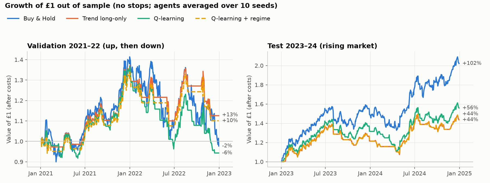
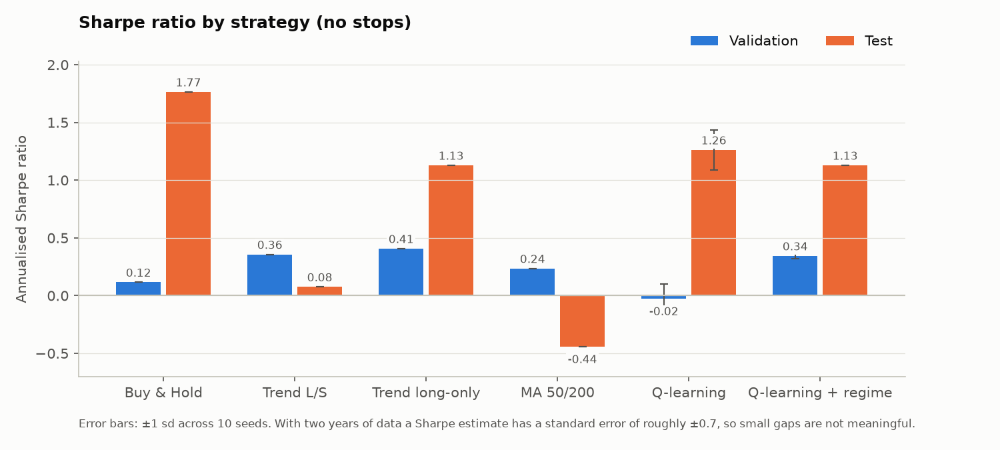
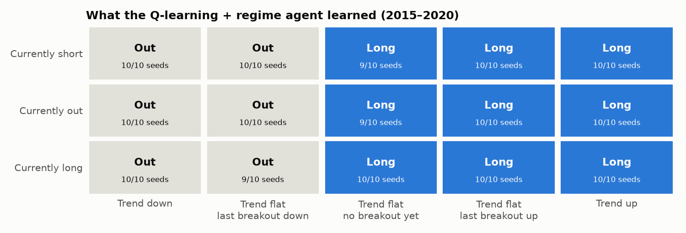
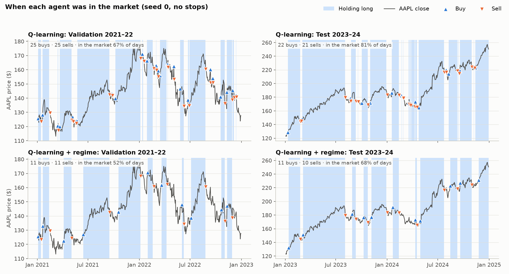

# Q-Learning for Stock Trading: What the Agent Actually Learns

A tabular Q-learning agent that trades one stock (AAPL, daily, 2015–2024), tested honestly against simple rule-based strategies with transaction costs, a chronological train / validation / test split and 10 random seeds.

**Main finding:** with a basic state (trend + position) the agent learns a reasonable rule but loses to buy-and-hold. Adding a single "regime" variable (the direction of the last breakout) lets it **rediscover a classic trend-following rule on its own, identically across all 10 seeds**. Out of sample, that rule cut losses when AAPL fell in 2022 but lagged buy-and-hold in the 2023–24 rally. **Over 2021–24 no strategy, learned or rule-based, beat buy-and-hold after costs.**



---

## Why this project

Most reinforcement-learning trading projects report a high return and stop there. The aim here was the opposite: set up a fair test first, then find out what the agent really learns and whether it holds up on data it has never seen. The interesting result turned out to be *why* the agent fails or succeeds, which comes down to what information is in its state.

## Setup

| | |
|---|---|
| **Data** | AAPL daily adjusted closes from Yahoo Finance, 2015–2024 |
| **Split** | Train 2015–2020 · Validation 2021–22 · Test 2023–24 (run once, after all design choices were fixed) |
| **Actions** | Short, out or long (fully invested either way), decided at each close |
| **Reward** | `log(1 + position × next-day return) − 0.1% × |change in position|` |
| **Agent** | Tabular Q-learning, γ = 0.99, ε-greedy (1.0 → 0.05), learning rate 1/n^0.6 per state–action ([Even-Dar & Mansour, 2003](#references)), 300 episodes |
| **Seeds** | 10 per agent; results reported as mean ± sd |
| **Benchmarks** | Buy & hold · trend rule long/short · trend rule long-only · 50/200-day moving-average crossover |

**State.** `Trend = price / 20-day average − 1`, split into three bins: down (below −2%), flat (within ±2%) and up (above +2%). Two versions of the agent are compared:

- **Q-learning:** state = (trend bin, current position)
- **Q-learning + regime:** state = (trend bin, last breakout direction, current position), where the last breakout is the most recent day the trend left the ±2% band. It only uses past data.

The trend rules use the same ±2% band, with hysteresis: inside the band they keep their current position.

## Results

### Test period 2023–24 (no stops)

| Strategy | Return | Sharpe | Max drawdown |
|---|---|---|---|
| **Buy & Hold** | **+102.1%** | **1.77** | **16.6%** |
| Trend L/S | −1.3% | 0.08 | 32.2% |
| Trend long-only | +43.6% | 1.13 | 22.7% |
| MA 50/200 | −20.9% | −0.44 | 34.6% |
| Q-learning | +55.8% ± 9.3% | 1.26 ± 0.17 | 22.9% |
| Q-learning + regime | +43.6% ± 0.0% | 1.13 ± 0.00 | 22.7% |

### Validation period 2021–22 (no stops)

| Strategy | Return | Sharpe | Max drawdown |
|---|---|---|---|
| Buy & Hold | −2.3% | 0.12 | 30.9% |
| Trend L/S | +13.3% | 0.36 | 28.4% |
| **Trend long-only** | **+12.6%** | **0.41** | **19.7%** |
| MA 50/200 | +5.1% | 0.24 | 38.5% |
| Q-learning | −5.7% ± 5.7% | −0.02 ± 0.13 | 31.5% |
| Q-learning + regime | +10.1% ± 0.9% | 0.34 ± 0.02 | 19.7% |



## What the results show

**1. Without memory, the agent can't learn the trend rule.** The basic agent learned "out when the trend is down, long otherwise" in all 10 seeds. That is reasonable, but it buys back in as soon as the price drifts into the flat band. The trend rule instead waits for a clear upward breakout. Its state holds no memory of the last breakout, so the agent cannot represent that waiting behaviour. This is a *state aliasing* problem: different situations look identical to the agent. It shows up even in training, where the agent scored +469% against the trend rule's +504%.

**2. With one extra variable, it rediscovers the rule.** Adding the regime variable makes the trend rule representable, and the agent finds it:



It stays out while the last breakout was down and goes long otherwise, with 9–10 out of 10 seeds agreeing in every state. On the test period its results match the hand-coded trend rule exactly (+43.6%, sd 0.0). In validation it trades far less than the basic agent (11 round trips against 25 for seed 0) and sits out much of the 2022 decline:



**3. Out of sample, trend following behaved like insurance.** It helped when AAPL fell in 2022 (+10% against −2% for buy-and-hold, with a third less drawdown). It cost a lot in the 2023–24 rally (+44% against +102%), because it stepped out on every dip and re-entered higher. Compounding both periods gives roughly +97% for buy-and-hold and +58% for the regime agent over 2021–24.

**4. Most differences are within noise.** With two years of daily data, an annualised Sharpe ratio has a standard error of roughly ±0.7 ([Lo, 2002](#references)). Only the larger gaps, such as buy-and-hold against the trend strategies in the test period, are clearly meaningful.

## Stop-loss and take-profit

Each strategy was also run with a hard-coded risk layer added at evaluation only: a 10% trailing stop, optionally with a 20% take-profit, followed by a 10-day cooldown. Return, with Sharpe in brackets:

| Strategy | Test: no stops | Test: stop 10% | Test: stop 10% + TP 20% | Validation: no stops | Validation: stop 10% + TP 20% |
|---|---|---|---|---|---|
| Buy & Hold | +102.1% (1.77) | +64.2% (1.31) | +52.6% (1.16) | −2.3% (0.12) | −27.0% (−0.54) |
| Trend long-only | +43.6% (1.13) | +43.6% (1.13) | +36.5% (1.00) | +12.6% (0.41) | +25.3% (0.73) |
| Q-learning + regime | +43.6% (1.13) | +43.6% (1.13) | +36.5% (1.00) | +10.1% (0.34) | +22.5% (0.65) |

Stops consistently hurt buy-and-hold, in both periods. They sell after a 10% pullback and the cooldown then misses the rebound. This matches [Kaminski & Lo (2014)](#references): stops only add value when price moves tend to continue. The apparent gains for the trend strategies in validation come from only 1 stop and 3 take-profits, too few to support a conclusion. Full results for every strategy and setting are in `results/`.

## Limitations

- **One stock, one decade.** AAPL had an unusually strong decade, which favours buy-and-hold. The results may not generalise to other stocks or markets.
- **Short evaluation windows.** Two years each for validation and test leave wide confidence intervals.
- **Simple execution model.** Trades fill at the daily close with a flat 0.1% cost. There is no slippage, no borrowing cost for shorts and no market impact.
- **Small state space.** Three trend bins and an optional regime flag. This is deliberate, because it makes the learned policy fully inspectable, but it limits what the agent can learn.

An earlier version also put the current trade's profit/loss in the state. The agent rarely saw large gains or losses during training, so it couldn't learn what to do with them, and it fell into a sell-and-rebuy loop. That feature was removed and replaced by the hard-coded risk layer above.

## Possible extensions

- Walk-forward evaluation (retrain each year on an expanding window) for more out-of-sample years
- Several stocks or indices chosen in advance, or one agent trained on all of them
- A volatility feature, or letting the agent choose its own stop level
- Function approximation (e.g. DQN, as in [Théate & Ernst, 2021](#references)) once the tabular results are understood

## How to run

```bash
pip install -r requirements.txt
python main.py     # downloads data once, trains 20 agents, prints and saves all tables (a few minutes)
python plots.py    # makes the figures in figures/ from the saved results
```

Each module also has a small self-check: `python env.py`, `python agent.py`, `python evaluate.py`.

## Project structure

```
data.py         download prices, build features (trend, moving averages, next-day return)
env.py          trading environment: state, reward, transaction costs, optional stop-loss / take-profit
agent.py        tabular Q-learning agent
baselines.py    rule-based benchmark strategies
evaluate.py     run a strategy through the environment; return, Sharpe, max drawdown
main.py         train, evaluate on validation and test, save results
plots.py        figures for this README
results/        all results tables, learned policies, daily equity curves and positions (CSV)
figures/        the figures above
```

## References

- Watkins, C. & Dayan, P. (1992). Q-learning. *Machine Learning*, 8, 279–292.
- Sutton, R. & Barto, A. (2018). *Reinforcement Learning: An Introduction* (2nd ed.). MIT Press.
- Even-Dar, E. & Mansour, Y. (2003). Learning rates for Q-learning. *Journal of Machine Learning Research*, 5, 1–25.
- Lo, A. (2002). The statistics of Sharpe ratios. *Financial Analysts Journal*, 58(4), 36–52.
- Kaminski, K. & Lo, A. (2014). When do stop-loss rules stop losses? *Journal of Financial Markets*, 18, 234–254.
- Théate, T. & Ernst, D. (2021). An application of deep reinforcement learning to algorithmic trading. *Expert Systems with Applications*, 173, 114632.

---

*Aryan Patel · MSc Mathematical Finance, University of Exeter*
